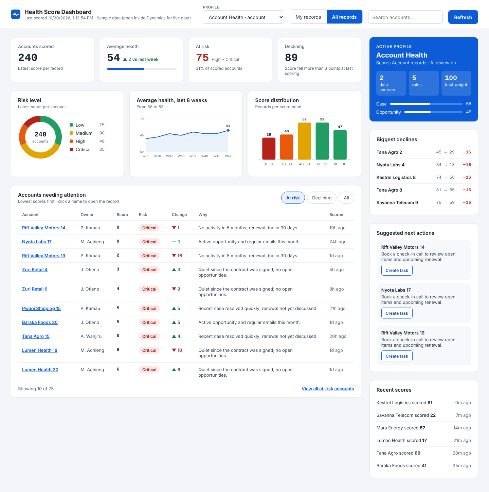
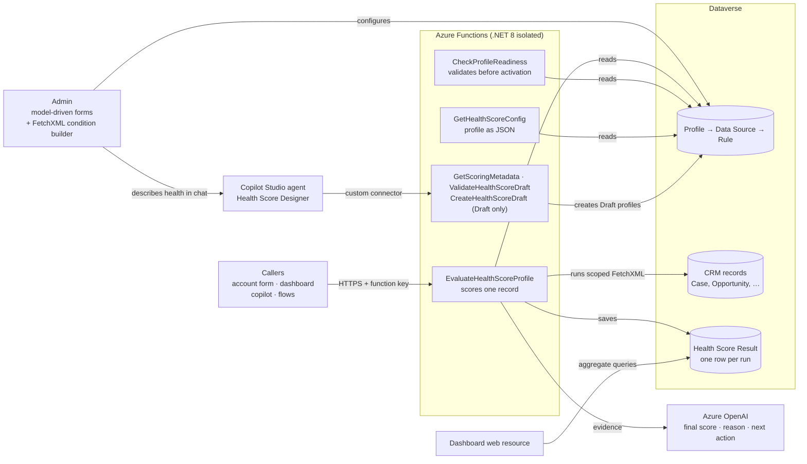

# Health Score AI Agent

[](https://github.com/Carol-Purity/HealthScore_AI_agent/actions/workflows/build.yml)


**A configurable, explainable health-scoring engine for Dynamics 365.** It scores any CRM record (accounts, opportunities, partners) from 0 to 100. A deterministic rules engine does the scoring, an LLM reviews the evidence and explains the result in plain business language, and guardrails keep the outcome auditable.

Admins build scoring models with point-and-click forms; no code changes are needed to add a signal. Salespeople get a score, a risk level, a trend, and a recommended next step.


<sub>The portfolio dashboard, a Dynamics web resource, shown with sample data.</sub>

---

## Why it exists

Sales teams can't read every email, case and opportunity to know which customers are drifting away. Health is usually judged by gut feel, inconsistently and too late. This engine reads the CRM evidence for each record, scores it against rules the business defines, and tells the salesperson **what is happening and what to do next**.

## What makes it interesting

| | |
|---|---|
| **Hybrid scoring: rules, then AI** | A deterministic rule score that the configuration fully explains, followed by an Azure OpenAI review that reads the actual records, adjusts the score and writes the explanation. |
| **Explainable by design** | Every point between the rule score and the final score is itemised in an audit trail. The engine also checks that each piece of evidence the AI quotes really exists in the data it was given (`evidenceFound`). |
| **Guardrails around the LLM** | A silence cap (no healthy evidence means the score can't exceed 20), scores clamped to 0–100, prompt-injection instructions, and a fallback to the rule score if the AI fails. A failure in the AI step never breaks a request. |
| **Metadata-driven and table-agnostic** | Profiles can target any Dataverse table. The engine resolves tables, name columns and relationships from metadata at runtime, and reads the link to the scored record directly from each rule's FetchXML. |
| **Safe query scoping** | The engine injects its own `AND` filter under each rule's `<entity>`, so no admin-written condition, OR groups included, can ever pull in another record's data. |
| **Scales to large portfolios** | The dashboard uses FetchXML aggregate queries for counts, averages and distributions, so it stays fast with thousands of records. "View all" hands off to native Dataverse views for paging, filtering and export. |
| **Configure with AI** | A Copilot Studio agent turns a plain-language description of health into a validated Draft profile. It never writes queries or activates anything: server code builds the FetchXML, every rule is test-run before saving, and a person activates through a readiness review. See [docs/copilot-agent.md](docs/copilot-agent.md). |
| **Low-friction admin experience** | The redesign removed a whole configuration layer. Tables and relationships are picked rather than typed, and a read-only readiness check validates a profile before it goes live. |

## Architecture



## How a score is calculated

1. **Load the profile.** This is the target table (e.g. Account), its enabled data sources (e.g. Case with weight 55, Opportunity with weight 45), and each source's rules.
2. **Run each rule.** Its FetchXML is limited to records linked to the record being scored. Every match is worth `points × direction`, where Impact sets the direction: Positive or Negative.
3. **Cap each source at its weight**, so no single signal can dominate:  `contribution = clamp(net, −weight, +weight)`.
4. **Calculate the rule score.** It's the sum of the contributions, clamped to 0–100. It's fully deterministic and reproducible.
5. **AI review.** The model sees the rule score and up to 5 sample records per rule. It returns a final score, itemised adjustments with quoted evidence, a 2–3 sentence reason, and a next action.
6. **Apply the guardrails and derive the labels.** The silence cap is applied, then the risk level (Low, Medium, High or Critical) and the trend compared with the previous score.
7. **Persist** the result, mark it as the record's latest score, and assign it to the record's owner.

Full detail: [docs/scoring-engine.md](docs/scoring-engine.md).

## Tech stack

**Backend:** C#, .NET 8, Azure Functions (isolated worker), Dataverse SDK (`ServiceClient`), FetchXML.
**AI:** Azure OpenAI (JSON mode, low temperature), a structured prompt with an audit contract.
**Platform:** Dynamics 365 / Dataverse, model-driven apps, PCF (FetchXML condition builder), form JavaScript.
**Front end:** a dependency-free HTML/JS dashboard with hand-drawn SVG charts, using the `Xrm.WebApi` and FetchXML aggregates.
**Tooling:** GitHub Actions CI.

## Repository layout

```
src/
  HealthScore.Functions/
    Functions/
      EvaluateHealthScoreProfile.cs   scoring engine (rules → AI review → guardrails → persist)
      CheckProfileReadiness.cs        read-only validation before a profile is activated
      GetHealthScoreConfig.cs         returns a profile's configuration as JSON
      GetScoringMetadata.cs           Copilot: tables, columns and operators the agent may use
      ValidateHealthScoreDraft.cs     Copilot: checks and test-runs a draft, previews the rule score
      CreateHealthScoreDraft.cs       Copilot: saves a validated draft as a Draft profile
    Copilot/                          draft model, validator and FetchXML builder
    Infrastructure/                   Dataverse connection, metadata cache, operators, request reader
    local.settings.example.json       settings template (names only, no secrets)
  webresources/
    reliance_healthdashboard.html     portfolio dashboard (profile-driven, any table)
    reliance_rulecondition.js         rule form script that pre-selects the source table
    reliance_aihealthscorehome.html   landing page: Configure with AI, profiles, Review
    reliance_reviewactivate.js        Review and activate dialog with downloadable report
    reliance_profileform.js           profile form: locking, checklist refresh, Done command
    reliance_profilechecklist.html    profile progress tracker; also a percentage bar control
  copilot-studio/
    agent/                            agent instructions and the confirm-and-create skill
    connector/                        custom connector (OpenAPI) for the Copilot functions
    samples/                          sample draft for testing
docs/
  architecture.md · scoring-engine.md · data-model.md · setup.md · copilot-agent.md
```

## Getting started

See **[docs/setup.md](docs/setup.md)** for the full setup. In short:

```bash
cp src/HealthScore.Functions/local.settings.example.json src/HealthScore.Functions/local.settings.json
# fill in the Dataverse app registration and Azure OpenAI values
cd src/HealthScore.Functions && func start
```

```bash
curl "http://localhost:7071/api/EvaluateHealthScoreProfile?profileId=<guid>&recordId=<guid>&preview=true&debug=true"
```

`preview=true` scores the record without saving anything. `debug=true` returns the exact evidence sent to the model.

## Roadmap

- [x] Configure with AI: a Copilot Studio agent that drafts profiles for human review

- [ ] Nightly batch scoring of every record on an Active profile
- [ ] Limit the AI to a fixed adjustment range (e.g. ±15), so the rule score always drives the result
- [ ] Optional recency decay per rule (a half-life in days)
- [ ] Back-test against known churn and renewal outcomes to measure how well the score predicts them
- [ ] Alerts when a record drops a risk level
- [ ] Deploy the Function App from GitHub Actions
- [ ] Copy an Active profile as a new Draft, and starter templates for the agent
- [ ] Move the agent to a sign-in channel before production

## Author

**Carolyne Purity**: design, Dataverse data model, engine, and dashboard.
