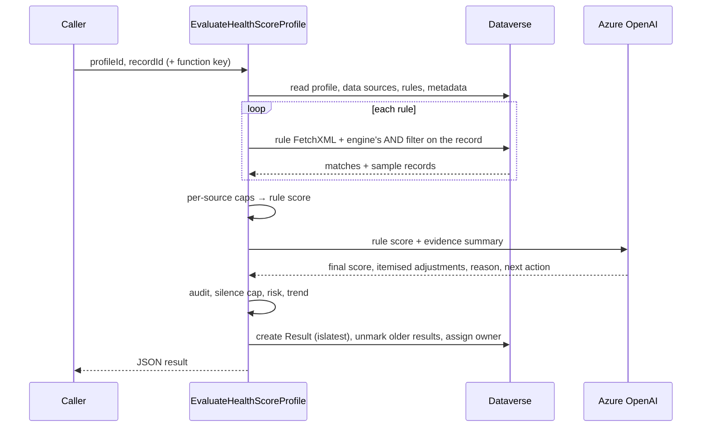

# Architecture

Configuration lives in **Dataverse** and is edited by admins in model-driven forms. Computation runs in **Azure Functions**, which read that configuration and the CRM data, call **Azure OpenAI**, and write results back to Dataverse. A **dashboard web resource** reads the results with aggregate queries.

## Components

| Component | Technology | Role |
|---|---|---|
| Configuration tables | Dataverse | Profile, Data Source, Rule: the scoring model |
| Results table | Dataverse | Every score, with reason, risk, trend, owner and an "is latest" flag |
| Admin forms | Model-driven app | Guided setup with a progress tracker and readiness review |
| Condition builder | PCF control | Point-and-click rule conditions that generate FetchXML |
| Rule form script | JavaScript (`reliance_rulecondition.js`) | Pre-selects the data source's table in the condition builder |
| Scoring engine | Azure Function | Rules, then AI review, then guardrails, then persist |
| Readiness check | Azure Function | Read-only validation, using exactly the engine's logic |
| Config reader | Azure Function | Returns a profile's configuration as JSON |
| Dashboard | HTML/JS web resource | Profile-driven portfolio view, hosted on a dashboard or as an app page |
| Health Score Designer | Copilot Studio agent + custom connector | Drafts profiles from a plain-language description ([copilot-agent.md](copilot-agent.md)) |
| Copilot functions | Azure Functions | Metadata discovery, draft validation with a dry run, and Draft-only creation |
| Landing page and review dialog | HTML/JS web resources | Entry point, readiness review, test scoring, activation and downloadable report |

## Request flow (one score)

## Design decisions

- **Rules first, AI second.** The rule score is deterministic and explainable. The AI adds judgment (recency, patterns, context) and explanation, and every change it makes is itemised against quoted evidence.
- **The relationship comes from the rule.** The link to the scored record is read from each rule's own FetchXML condition, so it's defined where the rule is built and can't silently point at the wrong column.
- **Generic over specific.** Nothing is hard-coded to Account. Table names, name columns, owners and links are resolved from metadata, so the same engine and dashboard serve any table.
- **One scoring implementation.** The readiness check validates using the engine's exact logic. The "try it on a record" preview calls the engine with `preview=true` instead of duplicating it.
- **Degrade, don't fail.** A broken rule or data source is skipped with a named warning, AI failures fall back to the rule score, and a failed owner assignment never blocks a save.

## Security

- Every function call requires a function key, and Dataverse is reached as an application user limited by its security role.
- Secrets live in app settings and never in code (see `local.settings.example.json`).
- Only an evidence summary is sent to Azure OpenAI, with values capped at 120 characters and HTML stripped.
- Prompt-injection defences: record text is declared as data, the score is clamped, the silence cap applies whatever the AI says, and quoted evidence is verified.
