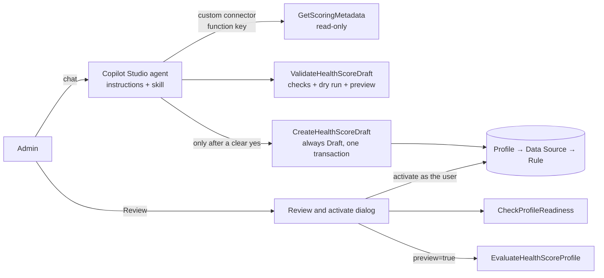

# Configure with AI: the Health Score Designer agent

The **Configure with AI** button on the Health Score landing page opens a Copilot Studio agent that turns an admin's plain-language description of account health into a working scoring profile, saved as a **Draft**. A person reviews it and activates it; the AI never activates anything.

The agent writes the same configuration tables the manual route uses (Profile → Data Source → Rule), so `EvaluateHealthScoreProfile` scores AI-drafted and hand-built profiles identically.

## Design principles

- **The AI drafts; a human decides.** Drafts only. Activation happens in a separate Review and activate dialog, run by a signed-in admin.
- **Deterministic where it matters.** The agent never writes FetchXML. It sends structured conditions; server code builds the query in one fixed, safe shape.
- **Nothing unchecked reaches Dataverse.** Every draft is checked against live metadata and every rule is test-run in Dataverse before it can be saved. Creation is all-or-nothing.
- **Say no plainly.** Requests the engine can't score are declined and recorded in the profile description, never silently approximated.

## Components



| Component | Location | Role |
|---|---|---|
| `GetScoringMetadata` | `Functions/` | Read-only discovery: tables related to the target, their relationship columns, usable columns with choice labels, and operators per column type |
| `ValidateHealthScoreDraft` | `Functions/` | Read-only. Checks a draft against metadata and the engine's rules, builds each rule's FetchXML, test-runs it, and with `?sampleRecordId` previews the rule score |
| `CreateHealthScoreDraft` | `Functions/` | The only write path. Re-validates, then creates the profile, data sources and rules in one `ExecuteTransactionRequest`, with Status hardcoded to Draft |
| `HealthScoreDraftModels.cs` | `Copilot/` | The draft structure (no status property by design), validation result and plain-language preview |
| `HealthScoreDraftValidator.cs` | `Copilot/` | All draft checks, the Dataverse dry run and the rule-score preview |
| `RuleFetchXmlBuilder.cs` | `Copilot/` | Structured conditions → FetchXML and a readable sentence |
| `EngineCapabilities.cs`, `DraftRequestReader.cs` | `Infrastructure/` | Column types and allowed operators; reading the draft from a request |
| Agent instructions and skill | `src/copilot-studio/agent/` | Paste into Copilot Studio |
| Custom connector | `src/copilot-studio/connector/` | OpenAPI definition for the three Copilot functions |
| Landing page, review dialog, profile form script, checklist | `src/webresources/` | The Dynamics side (below) |

## The agent

Built in Copilot Studio's instruction-led experience. Its tools are the three Copilot functions through the custom connector; web search is off and no generic Dataverse tool is attached, so Create is its only way to write.

**Conversation:** ask what "healthy", "at risk" and "worth knowing" mean → find related tables → read their columns → turn each signal into a rule using only real columns, labels and operators → recommend weights and points → validate silently (up to 3 fixes) → show the review → on a clear go-ahead, follow the `confirm-and-create` skill.

**Tone:** business language and display names, at most 6 short lines then one question, recommends rather than quizzes, never mentions JSON, validation or tools.

**Requests the engine can't score literally**

- *"Penalise accounts with no activity in 90 days"* → a Positive rule for activity in the last 90 days (silence earns nothing, and the AI review treats it as a risk).
- *"Make me aware of renewals, but don't score them"* → a Neutral rule. A data source with only Neutral rules is awareness only: it needs no weight and doesn't count towards the 100.
- Thresholds on counts or totals per record, conditions across two tables, and multi-select, file or image columns are declined and recorded.

**Confirm before create.** The skill re-validates, shows the final review, asks "Shall I create it?" and calls Create only on a clear yes. The instruction-led experience has no platform approval switch for tools, so this step relies on the skill; if it ever slipped, the result is an inert, validated Draft.

## Draft format

```json
{
  "profile": { "name": "Account Health v2", "targetTable": "account", "description": "…", "aiEnabled": true },
  "dataSources": [
    { "table": "incident", "relationshipColumn": "customerid", "weight": 30,
      "rules": [{ "name": "Open case that is high priority or over 30 days old", "impact": 2, "scoreValue": 10,
        "filter": { "type": "and",
          "conditions": [{ "column": "statecode", "operator": "eq", "value": "Active" }],
          "filters": [{ "type": "or", "conditions": [
            { "column": "prioritycode", "operator": "eq", "value": "High" },
            { "column": "createdon", "operator": "olderthan-x-days", "value": 30 } ] }] } }] }
  ],
  "unsupportedRequests": []
}
```

- `weight`: required and above 0 for sources with Positive or Negative rules; those weights total 100 or less. Awareness-only sources use 0.
- `impact`: 1 Positive, 2 Negative, 3 Neutral. `scoreValue`: points per matching record, positive; Impact sets the direction.
- `filter`: `and` / `or` groups, at most 3 levels. Values are choice labels as returned by metadata, numbers, `yyyy-MM-dd` dates, or whole-number day/month counts.

Every generated rule starts with a "Contains Data" condition on its relationship column, which is how the engine knows which lookup links the rule to the scored record:

```xml
<fetch><entity name="incident"><attribute name="incidentid"/>
  <filter type="and">
    <condition attribute="customerid" operator="not-null"/>
    <condition attribute="statecode" operator="eq" value="0"/>
    <filter type="or"> … </filter>
  </filter>
</entity></fetch>
```

## Dynamics side

| File (web resource name) | Role |
|---|---|
| `reliance_aihealthscorehome.html` (`reliance_AIHealthScoreHome.html`) | Landing page: **Configure with AI** opens the agent's web chat in a side panel; **Configure Manually**; the profile list with a **Review** button per row. Opening it with `profileId=<id>` opens the review dialog for that profile |
| `reliance_reviewactivate.js` (`reliance_ReviewActivate`) | Review and activate dialog: readiness checks, **Try it on a record** (engine preview with the full rule and AI breakdown), activation with a replace confirmation and rollback, deactivation, and **Download report** (a printable page with every check, the configuration and the test result) |
| `reliance_profileform.js` (`reliance_ProfileForm.js`) | Profile form: Status always read-only, Active profiles locked, checklist refresh, and the **Done** command that opens the review dialog |
| `reliance_profilechecklist.html` (`reliance_ProfileChecklist.html`) | On the Profile form: a Details → Data sources → Rules tracker with the specific next step. With the custom parameter `field=<text column>` it instead shows a percentage stored in a text column as a progress bar, on any form |

Activation runs in the browser through `Xrm.WebApi` as the signed-in admin, so Dataverse security and auditing apply. Checks are re-run at the moment of activation, and a profile with failed checks can't be activated.

## Setup

1. **Functions:** deploy the Function App as in [setup.md](setup.md). The Copilot functions use the same settings.
2. **Connector:** in `src/copilot-studio/connector/HealthScoreDesigner.swagger.json`, set `host` to the Function App's domain, then import it as a custom connector (API key, parameter `code`, in the query). Create the connection with the Function App's **default host key**; a single function's key returns 401 on the others.
3. **Agent:** create an agent, paste `agent/instructions.md` as its instructions, add the skill from `agent/skills/confirm-and-create/SKILL.md`, and add the connector's three operations as tools. Turn web search off. **Publish**: the embedded chat only sees published changes.
4. **Web resources:** upload the four files with the web resource names above. Set `AGENT_URL` in the landing page (the `src` of the agent's web app embed code) and `FUNCTION_BASE` / `FUNCTION_KEY` in the review dialog. Never commit real values.
5. **Profile form:** add `reliance_ProfileForm.js` (On Load: `HealthScoreProfileForm.onLoad`, pass execution context), the **Done** command (`HealthScoreProfileForm.done`, parameter PrimaryControl), and the checklist web resource (tick "pass record object-type code and unique identifier", about 4 rows).

Test the backend with `src/copilot-studio/samples/sample-draft.json`:

```bash
curl -X POST "https://<app>.azurewebsites.net/api/ValidateHealthScoreDraft?code=<key>&sampleRecordId=<account guid>" \
     -H "Content-Type: application/json" --data @src/copilot-studio/samples/sample-draft.json
```

The rule score in `previewText` should equal the `ruleScore` the engine returns for the created profile with `preview=true`.

## Limitations

- The web chat embed requires the agent to allow anonymous use, so anyone with its link could create Drafts through the connector's connection. Move to a sign-in channel (Teams or Microsoft 365) before production; the landing page switches with `AI_MODE = "newtab"`.
- The review dialog carries a function key in browser code, like the other browser callers.
- Data Source and Rule forms of Active profiles aren't locked yet, and imports or bulk edits aren't blocked.
