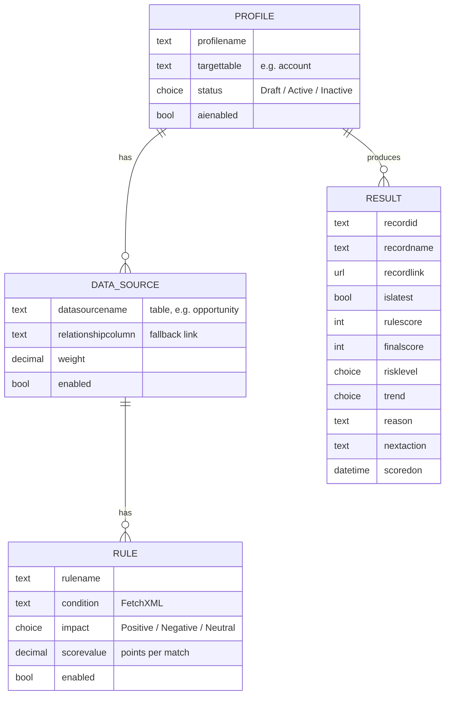

# Data model

The scoring model is a three-level hierarchy, **Profile → Data Source → Rule**, and every scoring run is stored in **Health Score Result**. All tables use the `reliance_` publisher prefix.

## Health Score Profile: `reliance_healthscoreprofile`

A profile defines how one kind of record is scored, for example "Account Health" for the Account table.

| Column | Type | Purpose |
|---|---|---|
| `reliance_profilename` | Text | Name shown to admins |
| `reliance_description` | Multiline text | What the profile measures |
| `reliance_targettable` | Table (text) | The table being scored. Every rule must link back to it |
| `reliance_status` | Choice: 1 Draft, 2 Active, 3 Inactive | Lifecycle, set through "Review and activate" |
| `reliance_aienabled` | Yes/No | When No, the final score is the rule score |

## Health Score Data Source: `reliance_healthscoredatasource`

A data source is one related table that feeds the score, with its importance.

| Column | Type | Purpose |
|---|---|---|
| `reliance_datasourcename` | Table (text) | The source table. Accepts `opportunity` or `Opportunity (opportunity)` |
| `reliance_relationshipcolumn` | Text | A **fallback** lookup to the target table. The engine prefers the lookup named in each rule's condition |
| `reliance_weight` | Decimal | The most this source can add to, or take from, the score. Weights should total 100 |
| `reliance_enabled` | Yes/No | Disabled sources are ignored |
| `reliance_healthscoreprofile` | Lookup | Parent profile |

## Health Score Rule: `reliance_healthscorerule`

A rule is one scoring signal.

| Column | Type | Purpose |
|---|---|---|
| `reliance_rulename` | Text | Shown to admins and in the AI evidence |
| `reliance_condition` | Multiline text (PCF condition builder) | The FetchXML. Its `<entity>` must be the data source's table |
| `reliance_impact` | Choice: 1 Positive, 2 Negative, 3 Neutral | Direction |
| `reliance_scorevalue` | Decimal | Points per matching record. The sign is ignored and blank counts as 1 |
| `reliance_enabled` | Yes/No | Disabled rules are ignored |
| `reliance_datasourcelookup` | Lookup | Parent data source |

## Health Score Result: `reliance_healthscoreresult`

A result is one scoring run for one record. Results are never overwritten, so the table is also the score history.

| Column | Type | Purpose |
|---|---|---|
| `reliance_healthscoreprofile` | Lookup | The profile that produced it |
| `reliance_recordid` | Text | The scored record's ID |
| `reliance_recordname` | Text | The record's name, read from the table's primary name column |
| `reliance_recordlink` | URL | Opens the record; works for any table |
| `reliance_islatest` | Yes/No | Yes on exactly one result per profile and record, which views and the dashboard filter on |
| `reliance_rulescore` | Whole number | Deterministic score (0–100) |
| `reliance_finalscore` | Whole number | Score after AI review and guardrails (0–100) |
| `reliance_risklevel` | Choice: 1 Low, 2 Medium, 3 High, 4 Critical | Derived from the final score |
| `reliance_trend` | Choice: 1 Improving, 2 Stable, 3 Declining | Compared with the previous result |
| `reliance_reason` | Multiline text | Explanation for the salesperson |
| `reliance_nextaction` | Multiline text | One recommended next step |
| `reliance_scoredon` | Date and time | When it was scored |
| `ownerid` | Owner | Copied from the scored record, so "My" views and security follow the record |

## Views on Health Score Result

| View | Filter |
|---|---|
| At-risk records | Is Latest = Yes, Risk Level in (High, Critical) |
| Declining records | Is Latest = Yes, Trend = Declining |
| All current scores | Is Latest = Yes |
